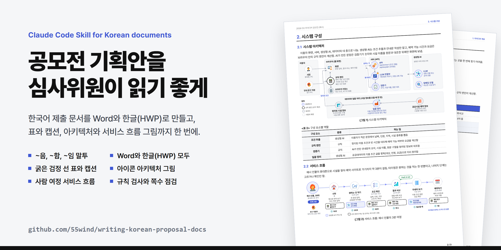
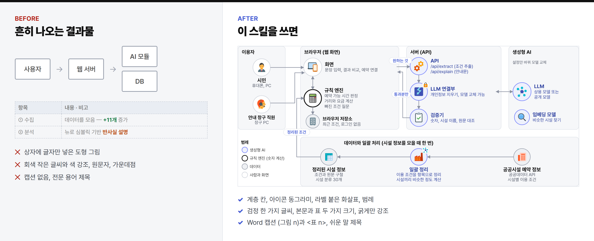
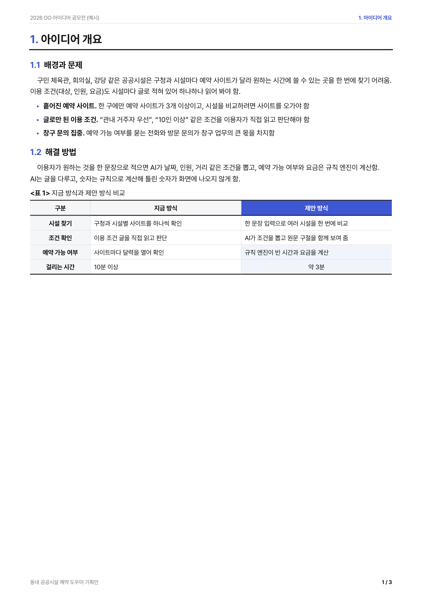
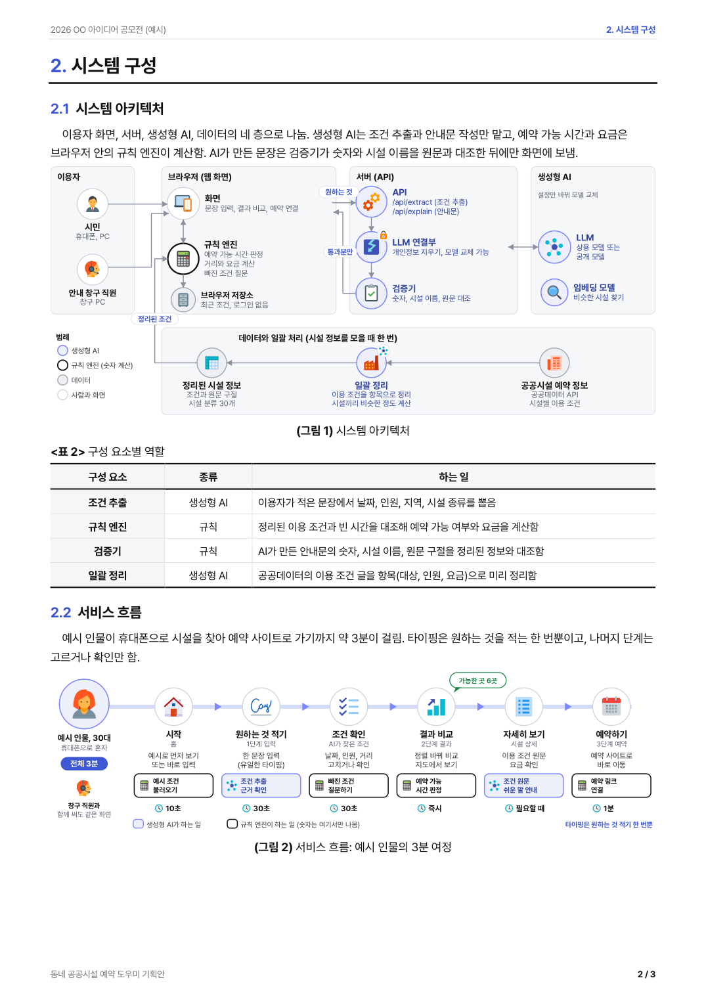
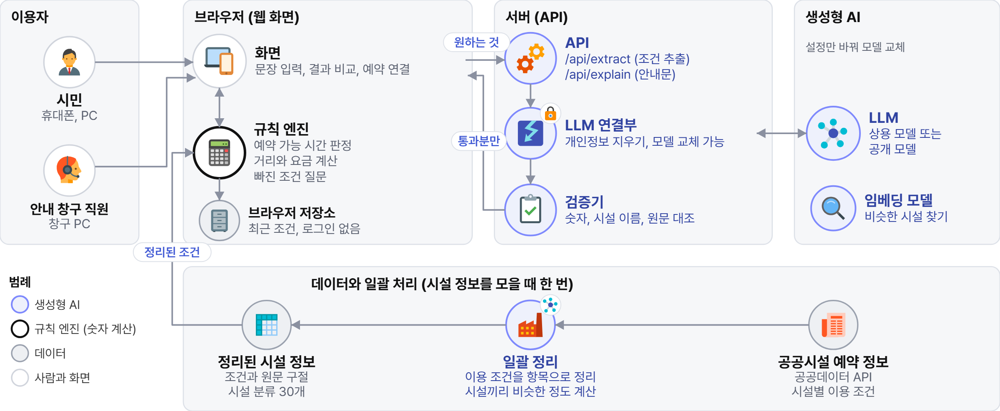
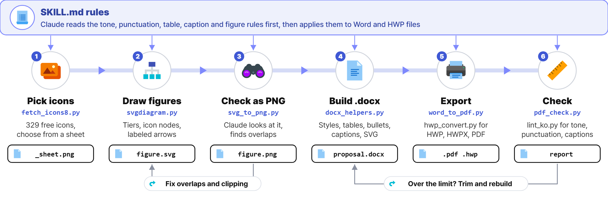

<div align="center">



# writing-korean-proposal-docs

**A Claude Code skill for Korean submission documents (contest proposals, business plans, project proposals) in Word and Hangul (HWP), written the way Korean reviewers expect.**

[한국어](README.md) | **English**

[](https://docs.claude.com/en/docs/claude-code/skills)
[](LICENSE)
[](https://www.python.org/)
[](#preview)

</div>

---

Ask an AI to write a Korean proposal and you often get the same problems: diagrams that are just boxes with text, gray small print and rainbow highlights, circled numbers and middle dots, tables without captions, a mix of polite and noun-ending sentence styles, and a PDF that goes over the page limit.

This skill turns the corrections from real submission documents into **rules** (`SKILL.md`) and **tools** (Python scripts). Claude follows the rules from the first draft, so you do not have to give the same feedback twice. It can also **fill in an HWP form** handed out by an agency, and **check and fix an existing HWP document**.

<div align="center">

</div>

## Contents

- [What it does](#what-it-does)
- [Preview](#preview)
- [Install](#install)
- [Just ask](#just-ask)
- [Rules at a glance](#rules-at-a-glance)
- [How it works](#how-it-works)
- [Hangul (HWP) documents](#hangul-hwp-documents)
- [Layout and scripts](#layout-and-scripts)
- [Run the example](#run-the-example)
- [FAQ](#faq)
- [License and credits](#license-and-credits)

## What it does

| Feature | Details |
|---|---|
| **Submission tone** | Every sentence ends in the concise Korean report style (~음, ~함, ~임). No em dashes, middle dots or circled numbers. Headings and captions describe what the system does in plain words instead of jargon. |
| **Readable formatting** | Black text only, two sizes only (body and table). Bold is the only emphasis. First-line indent of one character. Lists use real Word bullets. |
| **Review-ready tables** | Vertically centered cells, a thick black rule on top, under the header and at the bottom, thin light-gray rules between cells. Header rows repeat on each page and rows never split across pages. |
| **Word captions** | Real Word captions (Caption style + SEQ field): `(그림 1)` centered below figures and `<표 1>` above tables on the left. Numbers stay correct when you move things around. |
| **Icon-based architecture figures** | Tier panels, icons in circles, labeled arrows and a legend. Ring styles separate generative AI, rule engines and data. Uses 329 free icons (Icons8 Flat Color Icons, MIT). |
| **Service-flow figures** | Drawn as a persona's journey. Each step shows what the user does, what the AI or rule engine does, and how long it takes. |
| **Vector all the way** | Figures go into Word as SVG and stay vector in the PDF. |
| **Page checks** | Exports the PDF through Word or Hangul, then reports page count, remaining space per page, embedded fonts, and pages where text was rasterized. |
| **Hangul (HWP) support** | Fill HWP forms, turn a Word document into an HWP file, change text in HWPX while keeping all formatting, export PDF through Hangul. Includes a guide to HWP-only pitfalls with page breaks, tables and captions. |
| **Rule checker** | Reads `.hwp`, `.hwpx`, `.docx` and `.pdf` directly, without Hangul or Word, and finds middle dots, em dashes, circled numbers, special spaces, polite or plain sentence endings, and caption format problems. |

## Preview

These come straight from the bundled example (a fictional "neighborhood public facility booking assistant" proposal).

<table>
<tr>
<td width="50%"></td>
<td width="50%"></td>
</tr>
<tr>
<td align="center"><b>Page 1</b> overview, bullets, &lt;표 1&gt;</td>
<td align="center"><b>Page 2</b> (그림 1) architecture, &lt;표 2&gt;, (그림 2) service flow</td>
</tr>
</table>

**System architecture** (`examples/example_diagrams.py`)



**Service flow**


## Install

### Option 1. Claude Code plugin (recommended)

Run these inside Claude Code:

```text
/plugin marketplace add 55wind/writing-korean-proposal-docs
/plugin install writing-korean-proposal-docs@korean-proposal-docs
```

### Option 2. Copy into your skills folder

**macOS, Linux**

```bash
git clone --depth 1 https://github.com/55wind/writing-korean-proposal-docs.git /tmp/wkpd
mkdir -p ~/.claude/skills
cp -r /tmp/wkpd/skills/writing-korean-proposal-docs ~/.claude/skills/
```

**Windows (PowerShell)**

```powershell
git clone --depth 1 https://github.com/55wind/writing-korean-proposal-docs.git $env:TEMP\wkpd
New-Item -ItemType Directory -Force "$HOME\.claude\skills" | Out-Null
Copy-Item -Recurse "$env:TEMP\wkpd\skills\writing-korean-proposal-docs" "$HOME\.claude\skills\"
```

### Requirements

```bash
pip install -r requirements.txt
python -m playwright install chromium
```

| Item | Used for |
|---|---|
| Python 3.10+, `python-docx` | Building Word documents |
| `PyMuPDF`, `Pillow` | Icon contact sheets, PDF checks |
| `playwright` + Chromium | Rendering SVG figures to PNG for visual checks |
| [Pretendard](https://github.com/orioncactus/pretendard) **TTF build** | Document and figure font. Install the TTF files (`public/static/alternative/*.ttf`); with the OTF build Word rasterizes text in the PDF. |
| Windows + Microsoft Word, `pywin32` | `word_to_pdf.py` for PDF export and caption field updates (on macOS, save as PDF from Word) |
| `olefile`, `lxml` | Reading HWP text (`hwp_text.py`, `lint_ko.py`) and changing HWPX text (`hwpx_replace.py`). No Hangul needed. |
| Windows + Hancom Office Hangul 2018 or later, `pywin32` | `hwp_convert.py` for conversions between hwp, hwpx, docx and pdf. Register the automation security module (FilePathCheckerModule) so no access prompt blocks it. |

## Just ask

Once installed, ask as usual and Claude loads the skill when it fits. Prompts can be in Korean or English.

```text
Make a 10-page Word proposal for the OO idea contest, with a system architecture figure and a service-flow figure.
```

```text
Fix the tables in proposal.docx to the review rules and redo the captions with Word's caption feature.
```

```text
Turn the service-flow table in chapter 3 into an icon figure. Show me icon candidates first.
```

```text
Export to PDF and tell me whether it goes over 10 pages and how much space is left on each page.
```

```text
Fill the proposal body into the table cells of this application form .hwp. Keep the form's fonts and cells.
```

```text
Find every middle dot, em dash and polite sentence ending in my teammate's proposal.hwp and fix them. Keep the original file.
```

## Rules at a glance

The full rule set lives in [`SKILL.md`](skills/writing-korean-proposal-docs/SKILL.md) (written in Korean).

| Topic | Do | Don't |
|---|---|---|
| Tone | ~음, ~함, ~임 endings | Mixing polite (~합니다) endings |
| Punctuation | Commas, '와/과', '및' | Em dash (—), middle dot (·) |
| Numbering | Chapter and section numbers (1., 2.1) | Number badges, circled numbers (①②) |
| Text | Black, two sizes, bold for emphasis | Gray text, small side notes, colored highlights |
| Callouts | Indented paragraphs | Left-border boxes, KPI summary cards |
| Tables | Vertically centered, thick black top, header and bottom rules | Dashed lines, heavily tinted tables |
| Captions | Word captions: `(그림 1)` below, `<표 1>` above | Hand-typed numbers, no captions |
| Figures | Free color icons, tiers, labeled arrows, legend | Boxes and text only, emoji, stock photos |
| Format | HWP when the form is HWP, otherwise Word is the source. PDF exported from Word or Hangul | Printing HTML to PDF |

## How it works



<sub>This figure is drawn with the skill's own `svgdiagram.py` (`assets/make_how_it_works.py`).</sub>

1. **Pick icons.** List icon names, download candidates, and choose from a labeled contact sheet (`_sheet.png`).
2. **Draw figures.** Place `Canvas`, `tier`, `node` and `arrow` to build an SVG. No CSS, markers, clipPath or foreignObject, so Word can read it.
3. **Check as PNG.** Claude looks at the PNG and fixes overlaps and clipping.
4. **Build the .docx.** python-docx adds styles, tables, bullets, caption fields and SVG figures.
5. **Export.** Word updates fields (caption and page numbers) and exports the PDF. When an HWP file is required, `hwp_convert.py` makes HWP or HWPX and exports the PDF through Hangul.
6. **Check.** Page count, remaining space per page and fonts, plus `lint_ko.py` for punctuation, sentence endings and caption format. If it goes over the limit, decide what to trim and rebuild from step 4.

## Hangul (HWP) documents

Korean contests and government programs often hand out HWP forms. The same rules apply; pick the path that fits.

| Situation | Path |
|---|---|
| Filling an agency's HWP form, or polishing an HWP file your team has been editing | Convert `.hwp` to `.hwpx`, edit the XML, convert back to `.hwp` |
| Free format, but the submission must be an HWP file | Build in Word, open the .docx in Hangul, Save As .hwp and polish (Hancom Office 2018 automation hands .docx to Hanword and hangs) |
| Text-only fixes (middle dots, em dashes, sentence endings, terminology) | Find with `lint_ko.py`, replace in bulk with `hwpx_replace.py` |

```bash
python scripts/lint_ko.py proposal.hwp                          # checks directly, no Hangul needed
python scripts/hwp_convert.py proposal.hwp proposal.hwpx        # needs Hancom Office
python scripts/hwpx_replace.py proposal.hwpx fixed.hwpx --map replacements.tsv
python scripts/hwp_convert.py fixed.hwpx fixed.hwp
python scripts/hwp_convert.py fixed.hwp fixed.pdf               # to check page count
```

`hwpx_replace.py` changes text only and leaves formatting, tables and pictures alone. It drops the cached line layout of the paragraphs it touches so Hangul reflows them, and keeps the zip entry order of the original. Form cell padding, page breaks that do nothing inside table cells, floating tables, Hangul's caption feature, the equation editor and what to do when automation hangs are covered in [`reference/hwp.md`](skills/writing-korean-proposal-docs/reference/hwp.md) (Korean).

## Layout and scripts

```text
writing-korean-proposal-docs/
├── .claude-plugin/              # plugin and marketplace manifests
├── skills/writing-korean-proposal-docs/
│   ├── SKILL.md                 # the rules Claude reads (the skill itself)
│   ├── reference/hwp.md         # guide for Hangul (HWP, HWPX) documents
│   ├── scripts/
│   │   ├── docx_helpers.py      # python-docx helpers: tables, cells, fonts, fields, captions, SVG pictures
│   │   ├── svgdiagram.py        # tiny SVG library for icon architecture and service-flow figures
│   │   ├── fetch_icons8.py      # download Icons8 Flat Color Icons and build a contact sheet
│   │   ├── svg_to_png.py        # SVG to PNG with headless Chromium
│   │   ├── word_to_pdf.py       # export PDF through Word, update fields, embed fonts
│   │   ├── pdf_check.py         # page count, remaining space, fonts, raster images
│   │   ├── lint_ko.py           # rule checker (hwp, hwpx, docx, pdf, txt)
│   │   ├── hwp_text.py          # paragraph text from HWP, Word and PDF files
│   │   ├── hwpx_replace.py      # change HWPX text, keep formatting
│   │   └── hwp_convert.py       # hwp, hwpx, docx, pdf conversion through Hancom Office
│   └── examples/
│       ├── example_diagrams.py  # the two example figures
│       └── example_build_docx.py# the 3-page example proposal
└── assets/                      # README images
```

| Script | What it does | Needs |
|---|---|---|
| `docx_helpers.py` | Adds paragraphs, tables, cell formatting, fonts, fields, captions and SVG pictures (with PNG fallback) while keeping Word's XML schema order | python-docx |
| `svgdiagram.py` | Draws Word-safe SVG with tiers, icon nodes, labeled arrows and badges | nothing |
| `fetch_icons8.py` | `--list` prints all 329 icon names; saves chosen SVGs and a contact sheet | internet, PyMuPDF, Pillow |
| `svg_to_png.py` | Renders SVG to PNG with your installed fonts | Playwright Chromium |
| `word_to_pdf.py` | Updates fields and exports PDF; `--embed-fonts` embeds fonts, `--pages N` warns over N pages | Windows, Word, pywin32 |
| `pdf_check.py` | Remaining space per page (mm), embedded fonts, raster images per page | PyMuPDF |
| `lint_ko.py` | Checks middle dots, em dashes, circled numbers, special spaces, polite and plain sentence endings, caption format and table mentions. Exit code 1 when it finds something | olefile (hwp), PyMuPDF (pdf) |
| `hwp_text.py` | Paragraph text and equation scripts from .hwp, .hwpx, .docx and .pdf | olefile (hwp) |
| `hwpx_replace.py` | Changes HWPX text from a replacement list, drops cached line layout of touched paragraphs, `--dry-run` to preview | lxml |
| `hwp_convert.py` | Converts between hwp, hwpx and docx, exports PDF, registers the security module, watches for hangs | Windows, Hancom Office Hangul, pywin32 |

## Run the example

```bash
cd skills/writing-korean-proposal-docs
python examples/example_diagrams.py          # examples/out/architecture.svg, service-flow.svg
python examples/example_build_docx.py        # examples/out/example_proposal.docx
python scripts/word_to_pdf.py examples/out/example_proposal.docx --pages 4   # Windows + Word
python scripts/pdf_check.py examples/out/example_proposal.pdf
```

## FAQ

<details>
<summary><b>Does it work with Hangul (HWP) documents?</b></summary>

Yes. The rule checker (`lint_ko.py`), text extraction (`hwp_text.py`) and HWPX text replacement (`hwpx_replace.py`) run without Hangul. Format conversion and PDF export through Hangul (`hwp_convert.py`) need Windows and Hancom Office Hangul. HWP files saved in distribution (read-only) mode have encrypted body text and cannot be read.
</details>

<details>
<summary><b>Can I use it on macOS?</b></summary>

Building documents, drawing figures, PNG checks, PDF checks and rule checks all work on macOS and Linux. Only `word_to_pdf.py` and `hwp_convert.py` use Word and Hangul automation on Windows; on macOS, save as PDF from Word or Hangul.
</details>

<details>
<summary><b>Can I use a font other than Pretendard?</b></summary>

Change `FONT_LATIN` and `FONT_EA` in `scripts/docx_helpers.py` and `FONT` in `scripts/svgdiagram.py`. Pick a font installed as TTF so it embeds cleanly in the PDF.
</details>

<details>
<summary><b>Can I use the icons in commercial documents?</b></summary>

The default set, Icons8 Flat Color Icons, is MIT licensed and states "free icons for personal and commercial use, no credits required". `fetch_icons8.py` writes a license note next to the downloaded icons.
</details>

<details>
<summary><b>Does it work outside Claude Code?</b></summary>

`SKILL.md` is plain Markdown and the scripts are plain Python, so you can give the rules to another AI coding tool or use the scripts yourself.
</details>

## Contributing

Issues and pull requests are welcome, especially:

- New reviewer feedback and the rule that prevents it
- PDF export for macOS and LibreOffice
- Examples for new figure types (org charts, timelines)

## License and credits

- This repository: [MIT](LICENSE)
- Icons: [Icons8 Flat Color Icons](https://github.com/icons8/flat-color-icons) (MIT)
- Font: [Pretendard](https://github.com/orioncactus/pretendard) (SIL Open Font License 1.1)
- Libraries: [python-docx](https://github.com/python-openxml/python-docx), [PyMuPDF](https://github.com/pymupdf/PyMuPDF), [Playwright](https://playwright.dev/python/)

<div align="center">

If this helps, a ⭐ goes a long way.

</div>
