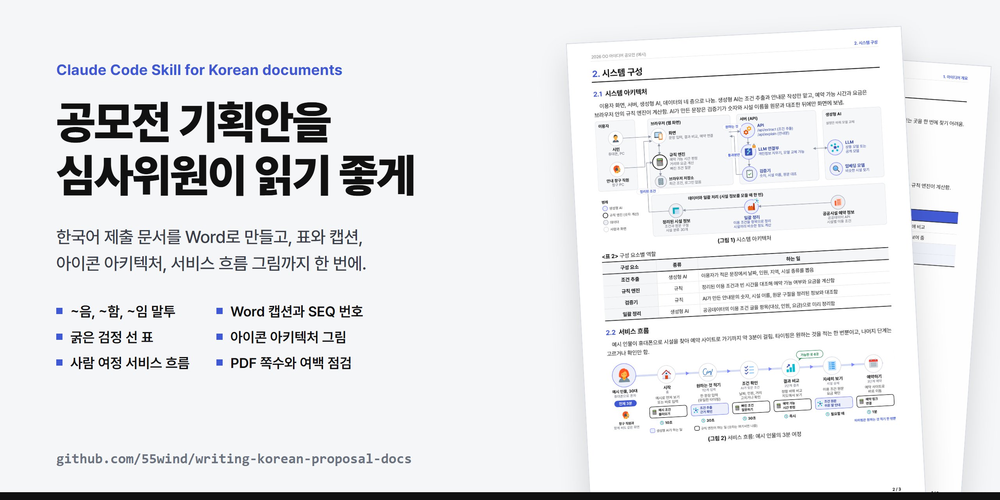
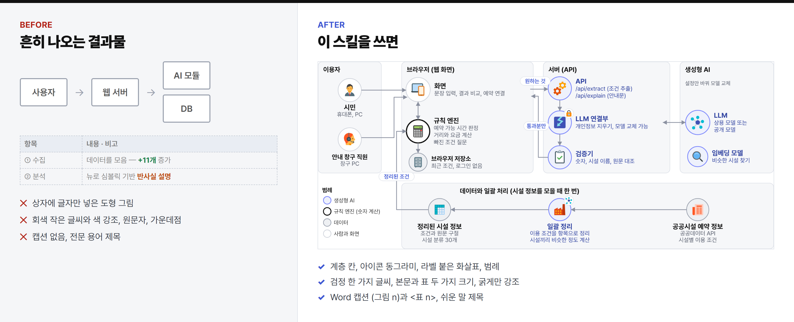
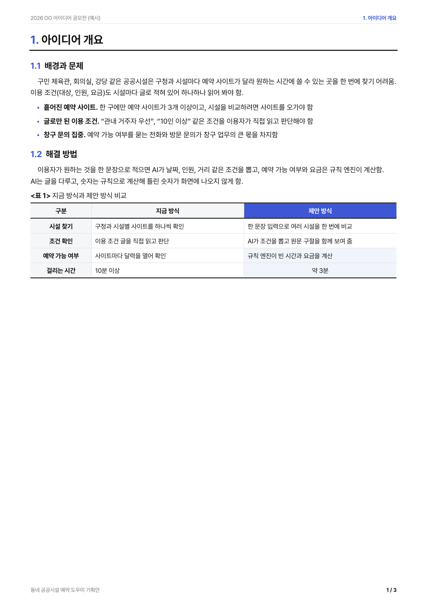
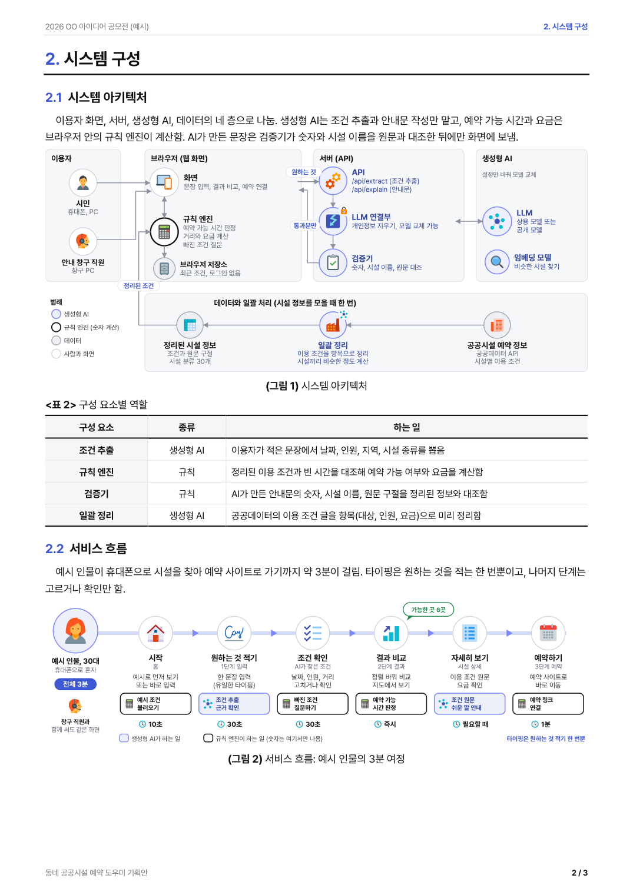
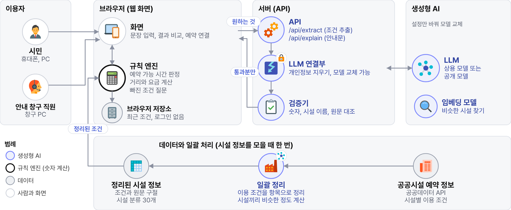
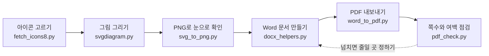

<div align="center">



# writing-korean-proposal-docs

**공모전 기획안, 제안서, 사업계획서를 심사위원이 읽기 좋은 Word 문서로 만드는 Claude Code 스킬**

**한국어** | [English](README.en.md)

[](https://docs.claude.com/en/docs/claude-code/skills)
[](LICENSE)
[](https://www.python.org/)
[](#결과물-미리보기)
[](#)

</div>

---

AI에게 기획안을 맡기면 자주 이런 문서가 나옵니다. 상자에 글자만 넣은 그림, 회색 작은 글씨와 알록달록한 강조, 원문자와 가운데점, 캡션 없는 표, "~합니다"와 "~함"이 섞인 말투, 그리고 제한 쪽수를 넘긴 PDF.

이 스킬은 실제 제출 문서를 고치면서 받은 지적을 **규칙**(SKILL.md)과 **도구**(Python 스크립트)로 묶었습니다. Claude가 처음부터 이 규칙대로 만들기 때문에 같은 지적을 두 번 받지 않습니다.

<div align="center">

</div>

## 목차

- [무엇을 해 주나요](#무엇을-해-주나요)
- [결과물 미리보기](#결과물-미리보기)
- [설치](#설치)
- [이렇게 말하면 됩니다](#이렇게-말하면-됩니다)
- [규칙 한눈에 보기](#규칙-한눈에-보기)
- [작동 방식](#작동-방식)
- [폴더 구성과 스크립트](#폴더-구성과-스크립트)
- [예제 직접 돌려 보기](#예제-직접-돌려-보기)
- [자주 묻는 질문](#자주-묻는-질문)
- [라이선스와 출처](#라이선스와-출처)

## 무엇을 해 주나요

| 기능 | 내용 |
|---|---|
| **제출 문서 말투** | 모든 문장을 '~음, ~함, ~임'으로 끝내고, 엠대시와 가운데점, 원문자를 쓰지 않습니다. 제목과 캡션에는 전문 용어 대신 하는 일을 쉬운 말로 씁니다. |
| **읽기 쉬운 서식** | 글씨는 검정 한 가지, 크기는 본문과 표 두 가지만 씁니다. 강조는 굵게만 하고, 문단 첫 줄은 한 글자 들여씁니다. 목록은 Word 글머리표로 만듭니다. |
| **심사용 표** | 세로 가운데 정렬, 표 위와 머리글 아래와 맨 아래는 굵은 검정 선, 칸 사이는 연회색 가는 선. 머리글 행이 쪽마다 반복되고 행이 쪽 사이에서 잘리지 않습니다. |
| **Word 캡션** | 캡션 스타일과 SEQ 필드로 `(그림 1)`은 그림 아래 가운데, `<표 1>`은 표 왼쪽 위에 답니다. 그림이나 표를 옮겨도 번호가 저절로 맞습니다. |
| **아이콘 아키텍처 그림** | 계층 칸, 아이콘 동그라미, 라벨 붙은 화살표, 범례로 그립니다. 생성형 AI, 규칙 엔진, 데이터를 테두리로 구분합니다. 무료 아이콘(Icons8 Flat Color Icons, MIT) 329개를 씁니다. |
| **서비스 흐름 그림** | 예시 인물이 단계를 지나가는 여정으로 그립니다. 단계마다 이용자가 하는 일, AI나 규칙 엔진이 하는 일, 걸리는 시간이 들어갑니다. |
| **벡터 그대로** | 그림은 SVG로 Word에 들어가고 PDF에서도 벡터로 남습니다. 확대해도 깨지지 않습니다. |
| **쪽수 점검** | Word로 PDF를 내보내고, 쪽수와 쪽마다 남은 여백, 들어간 글꼴, 글자가 그림으로 바뀐 쪽을 확인합니다. |

## 결과물 미리보기

아래는 저장소에 든 예제(가상의 "동네 공공시설 예약 도우미" 기획안)를 그대로 돌린 결과입니다.

<table>
<tr>
<td width="50%"></td>
<td width="50%"></td>
</tr>
<tr>
<td align="center"><b>1쪽</b> 개요, 글머리표, &lt;표 1&gt;</td>
<td align="center"><b>2쪽</b> (그림 1) 아키텍처, &lt;표 2&gt;, (그림 2) 서비스 흐름</td>
</tr>
</table>

**시스템 아키텍처** (`examples/example_diagrams.py`)



**서비스 흐름**


## 설치

### 방법 1. Claude Code 플러그인으로 설치 (추천)

Claude Code 안에서 아래 두 줄을 입력합니다.

```text
/plugin marketplace add 55wind/writing-korean-proposal-docs
/plugin install writing-korean-proposal-docs@korean-proposal-docs
```

### 방법 2. 스킬 폴더에 직접 복사

**macOS, Linux**

```bash
git clone --depth 1 https://github.com/55wind/writing-korean-proposal-docs.git /tmp/wkpd
mkdir -p ~/.claude/skills
cp -r /tmp/wkpd/skills/writing-korean-proposal-docs ~/.claude/skills/
```

**Windows (PowerShell)**

```powershell
git clone --depth 1 https://github.com/55wind/writing-korean-proposal-docs.git $env:TEMP\wkpd
New-Item -ItemType Directory -Force "$HOME\.claude\skills" | Out-Null
Copy-Item -Recurse "$env:TEMP\wkpd\skills\writing-korean-proposal-docs" "$HOME\.claude\skills\"
```

### 필요한 것

```bash
pip install -r requirements.txt
python -m playwright install chromium
```

| 항목 | 쓰는 곳 |
|---|---|
| Python 3.10 이상, `python-docx` | Word 문서 만들기 |
| `PyMuPDF`, `Pillow` | 아이콘 후보 시트, PDF 점검 |
| `playwright` + Chromium | SVG 그림을 PNG로 바꿔 확인하기 |
| [Pretendard](https://github.com/orioncactus/pretendard) **TTF판** | 문서와 그림의 글꼴. OTF판으로 설치하면 Word가 PDF에 글자를 그림으로 넣으니 꼭 TTF판(`public/static/alternative/*.ttf`)을 설치하세요. |
| Windows + Microsoft Word, `pywin32` | `word_to_pdf.py`로 PDF 내보내기와 캡션 번호 갱신 (macOS에서는 Word에서 직접 PDF로 저장) |

## 이렇게 말하면 됩니다

설치한 뒤에는 평소처럼 부탁하면 Claude가 스킬을 알아서 불러옵니다.

```text
OO 공모전 아이디어 기획안을 Word로 10쪽 안에 만들어 줘. 시스템 아키텍처 그림이랑 서비스 흐름 그림도 넣어 줘.
```

```text
이 제안서.docx 표를 심사용 규칙대로 고쳐 줘. 캡션도 Word 캡션 기능으로 다시 달아 줘.
```

```text
3장의 서비스 흐름 표를 아이콘 그림으로 바꿔 줘. 어떤 아이콘이 좋을지 후보부터 보여 줘.
```

```text
PDF로 내보내서 10쪽 넘는지, 쪽마다 여백이 얼마나 남는지 확인해 줘.
```

## 규칙 한눈에 보기

전체 규칙은 [`SKILL.md`](skills/writing-korean-proposal-docs/SKILL.md)에 있습니다.

| 항목 | 이렇게 | 이렇게 하지 않음 |
|---|---|---|
| 말투 | ~음, ~함, ~임 | ~합니다, ~해요 섞기 |
| 문장부호 | 쉼표, '와/과', '및' | 엠대시(—), 가운데점(·) |
| 번호 | 장과 절 번호(1., 2.1) | 번호 상자, 원문자(①②) |
| 글씨 | 검정 한 가지, 본문과 표 두 가지 크기, 굵게 강조 | 회색 글씨, 작은 보조 문단, 색 강조 |
| 강조 상자 | 들여쓴 문장 문단 | 왼쪽 색 선 상자, 숫자 요약 카드 |
| 표 | 세로 가운데, 굵은 검정 위와 머리글 아래와 맨 아래 선 | 점선, 색 바탕 가득한 표 |
| 캡션 | Word 캡션 `(그림 1)` 아래 가운데, `<표 1>` 왼쪽 위 | 손으로 친 번호, 캡션 없음 |
| 그림 | 무료 컬러 아이콘, 계층 칸, 라벨 화살표, 범례 | 상자와 글자만, 이모지, 스톡 사진 |
| 형식 | Word가 원본, PDF는 Word에서 내보내기 | HTML을 PDF로 찍기 |

## 작동 방식



1. **아이콘 고르기** 아이콘 이름 목록을 보고, 후보를 받아 이름표 붙은 미리보기 시트(`_sheet.png`)로 고릅니다.
2. **그림 그리기** `Canvas`, `tier`, `node`, `arrow`로 좌표를 잡아 SVG를 만듭니다. Word가 못 읽는 CSS, marker, clipPath, foreignObject는 쓰지 않습니다.
3. **PNG로 확인** Claude가 PNG를 직접 보고 겹침과 잘림을 고칩니다.
4. **Word 문서 만들기** python-docx로 스타일, 표, 글머리표, 캡션 필드, SVG 그림을 넣습니다.
5. **PDF 내보내기** Word가 필드(캡션 번호, 쪽 번호)를 갱신한 뒤 PDF로 내보냅니다.
6. **점검** 쪽수, 쪽별 남은 여백, 글꼴, 글자가 그림으로 바뀐 쪽을 확인합니다.

## 폴더 구성과 스크립트

```text
writing-korean-proposal-docs/
├── .claude-plugin/              # 플러그인과 마켓플레이스 정보
├── skills/writing-korean-proposal-docs/
│   ├── SKILL.md                 # Claude가 읽는 규칙 (이 스킬의 본체)
│   ├── scripts/
│   │   ├── docx_helpers.py      # python-docx 도우미: 표, 칸, 글꼴, 필드, 캡션, SVG 그림
│   │   ├── svgdiagram.py        # 아이콘 아키텍처와 서비스 흐름용 작은 SVG 라이브러리
│   │   ├── fetch_icons8.py      # Icons8 Flat Color Icons 받기와 후보 시트
│   │   ├── svg_to_png.py        # SVG를 PNG로 (헤드리스 Chromium)
│   │   ├── word_to_pdf.py       # Word로 PDF 내보내기, 필드 갱신, 글꼴 넣기
│   │   └── pdf_check.py         # 쪽수, 남은 여백, 글꼴, 래스터 이미지 점검
│   └── examples/
│       ├── example_diagrams.py  # 예제 그림 두 장
│       └── example_build_docx.py# 예제 기획안 3쪽
└── assets/                      # README 이미지
```

| 스크립트 | 하는 일 | 필요 조건 |
|---|---|---|
| `docx_helpers.py` | Word XML 스키마 순서를 지키며 문단, 표, 칸 서식, 글꼴, 필드, 캡션, SVG 그림(PNG 대체 포함)을 넣음 | python-docx |
| `svgdiagram.py` | 계층 칸, 아이콘 노드, 라벨 화살표, 배지로 Word에 넣을 수 있는 SVG를 그림 | 없음 |
| `fetch_icons8.py` | `--list`로 아이콘 329개 이름 출력, 고른 아이콘 SVG 저장과 후보 시트 생성 | 인터넷, PyMuPDF, Pillow |
| `svg_to_png.py` | 설치된 글꼴 그대로 SVG를 PNG로 바꿈 | Playwright Chromium |
| `word_to_pdf.py` | 필드 갱신 뒤 PDF 내보내기, `--embed-fonts`로 글꼴 넣기, `--pages N`으로 쪽수 경고 | Windows, Word, pywin32 |
| `pdf_check.py` | 쪽별 남은 여백(mm), 들어간 글꼴, 쪽별 래스터 이미지 수 | PyMuPDF |

## 예제 직접 돌려 보기

```bash
cd skills/writing-korean-proposal-docs
python examples/example_diagrams.py          # examples/out/architecture.svg, service-flow.svg
python examples/example_build_docx.py        # examples/out/example_proposal.docx
python scripts/word_to_pdf.py examples/out/example_proposal.docx --pages 4   # Windows + Word
python scripts/pdf_check.py examples/out/example_proposal.pdf
```

## 자주 묻는 질문

<details>
<summary><b>한글(HWP) 문서도 되나요?</b></summary>

이 스킬은 Word(.docx)를 기준으로 합니다. 한글에서 docx를 열 수는 있지만 줄 간격과 표 모양이 조금 달라질 수 있습니다. 말투, 문장부호, 표, 캡션, 그림 규칙은 한글 문서에도 그대로 쓸 수 있습니다.
</details>

<details>
<summary><b>macOS에서도 쓸 수 있나요?</b></summary>

문서 만들기, 그림 그리기, PNG 확인, PDF 점검은 macOS와 Linux에서도 됩니다. `word_to_pdf.py`만 Windows의 Word 자동화를 쓰므로, macOS에서는 Word에서 직접 PDF로 저장하세요.
</details>

<details>
<summary><b>Pretendard 말고 다른 글꼴을 쓰고 싶어요.</b></summary>

`scripts/docx_helpers.py`의 `FONT_LATIN`, `FONT_EA`와 `scripts/svgdiagram.py`의 `FONT`를 바꾸면 됩니다. PDF에 글꼴이 제대로 들어가려면 TTF판으로 설치된 글꼴을 고르세요.
</details>

<details>
<summary><b>아이콘을 상업 문서에 써도 되나요?</b></summary>

기본 아이콘인 Icons8 Flat Color Icons는 MIT 라이선스이고 "개인과 상업 용도 무료, 출처 표기 불필요"라고 밝히고 있습니다. `fetch_icons8.py`가 받은 폴더에 라이선스 메모를 함께 남깁니다.
</details>

<details>
<summary><b>Claude Code가 아니어도 쓸 수 있나요?</b></summary>

`SKILL.md`는 평범한 마크다운이고 스크립트는 일반 Python이라, 다른 AI 코딩 도구에 규칙 파일로 넣거나 사람이 직접 써도 됩니다.
</details>

## 기여

규칙이나 스크립트를 고치고 싶다면 이슈나 풀 리퀘스트를 보내 주세요. 특히 이런 기여를 반깁니다.

- 심사에서 받은 새로운 지적과 그에 맞는 규칙
- macOS와 LibreOffice용 PDF 내보내기
- 새로운 그림 유형(조직도, 일정표 등) 예제

## 라이선스와 출처

- 이 저장소: [MIT](LICENSE)
- 아이콘: [Icons8 Flat Color Icons](https://github.com/icons8/flat-color-icons) (MIT)
- 글꼴: [Pretendard](https://github.com/orioncactus/pretendard) (SIL Open Font License 1.1)
- 라이브러리: [python-docx](https://github.com/python-openxml/python-docx), [PyMuPDF](https://github.com/pymupdf/PyMuPDF), [Playwright](https://playwright.dev/python/)

<div align="center">

도움이 됐다면 ⭐ 하나가 큰 힘이 됩니다.

</div>
